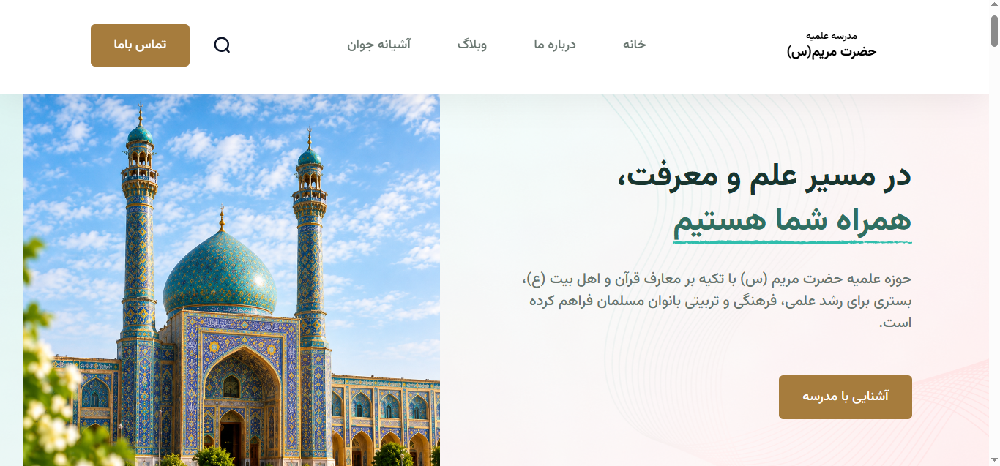

# Seminary Website Frontend

A responsive and user-friendly frontend website for a seminary school, built to present educational content and provide visitors with a clean and accessible browsing experience.

## ✨ Features

* Responsive website layout
* Clean and modern user interface
* User-friendly navigation
* Organized content presentation
* Interactive elements using JavaScript

## 🛠️ Technologies Used

* **HTML5** — Website structure
* **CSS3** — Styling and responsive layout
* **JavaScript** — Interactive functionality

## 📸 Screenshots

### Homepage



## 🚀 Getting Started

### Clone the repository

```bash
git clone https://github.com/MHoseini-Developer/seminary-website-frontend.git
```

### Run the project

1. Open the project folder.
2. Open `index.html` in your browser.

No additional installation is required.

## 👩‍💻 Developer

**Masoumeh Hoseini**

Frontend Developer

* GitHub: [MHoseini-Developer](https://github.com/MHoseini-Developer)

---

*Developed with HTML, CSS, and JavaScript.*

# وب‌سایت مدرسه علمیه

یک وب‌سایت واکنش‌گرا و کاربرپسند برای مدرسه علمیه که با هدف ارائه محتوای آموزشی و فراهم کردن تجربه‌ای ساده و مناسب برای بازدیدکنندگان طراحی و توسعه داده شده است.

## ✨ امکانات

* طراحی واکنش‌گرا و سازگار با اندازه‌های مختلف صفحه‌نمایش
* رابط کاربری ساده و مدرن
* ناوبری آسان بین بخش‌های وب‌سایت
* نمایش منظم محتوای آموزشی
* عناصر تعاملی با استفاده از JavaScript

## 🛠️ فناوری‌های استفاده‌شده

* **HTML5:** ساختار صفحات وب
* **CSS3:** طراحی ظاهری و چیدمان واکنش‌گرا
* **JavaScript:** پیاده‌سازی قابلیت‌های تعاملی

## 📸 تصاویر پروژه

### صفحه اصلی


## 🚀 اجرای پروژه

### دریافت پروژه

```bash
git clone https://github.com/MHoseini-Developer/seminary-website-frontend.git
```

### اجرا

۱. وارد پوشه پروژه شوید.

۲. فایل `index.html` را در مرورگر باز کنید.

برای اجرای نسخه فعلی پروژه، نصب وابستگی اضافی لازم نیست.

## 👩‍💻 توسعه‌دهنده

**معصومه حسینی**

توسعه‌دهنده فرانت‌اند

* گیت‌هاب: [MHoseini-Developer](https://github.com/MHoseini-Developer)

---

*توسعه‌یافته با HTML، CSS و JavaScript*
